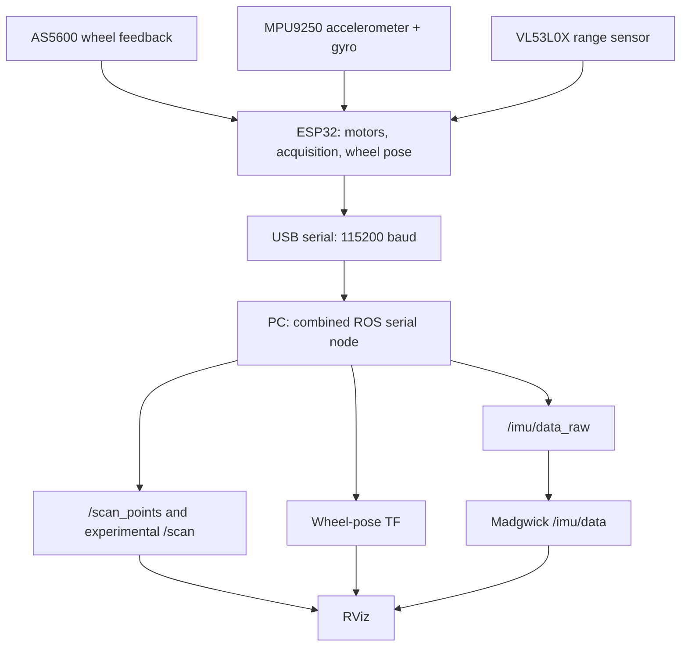

# MIC ROS AMR
### A small robot. A complete engineering learning path.

**ESP32 · ROS 2 Humble · Added magnetic encoders · Single-point ToF scanning · 3D-printed chassis**

<p align="center"></p>

[Watch the distance test](media/videos/distance-floor-test.mp4) · [See the square trajectory](media/videos/rviz-square-trajectory.mp4) · [Explore the milestones](milestones/README.md) · [Build and run](docs/setup.md)

## Why I built this

I built MIC ROS AMR to explore how far simple, affordable hardware can take a mobile robotics project. It is a platform for learning motion control, odometry, orientation estimation and the foundations needed for SLAM and navigation, with the ROS 2 processing running on a connected PC.

The robot carries an ESP32 for motor control, sensor acquisition and wheel-pose integration. A PC handles the ROS pipeline over serial, so an onboard Linux computer is not required. The chassis is 3D printed, and a 3.7 V high-discharge lithium cell feeds an MT3608 boost module set to 5 V for the motor supply and ESP32 board power input.

The N20 geared motors had no built-in encoders. I added **AS5600 magnetic encoders** on separate I²C buses and developed wheel-speed feedback, synchronization and count-based motion tasks. For environmental sensing, a **single VL53L0X ToF sensor** gathers distances as the robot rotates. Those measurements and wheel-derived heading are used to reconstruct a sparse scan and an odometry-frame point cloud.

The work lies in making these basic components cooperate: replacing a faulty motor, checking real wheel directions, resolving encoder signs, investigating RPM fluctuations, tuning straight and turning motion, calibrating gyro offsets, and getting the data into consistent ROS frames. This repository includes the small experiments as well as the integrated source, so that progression can be followed step by step.

**Current focus:** integrated sensing and scan visualization. **Next:** validate scan geometry and restore a reproducible EKF setup, then evaluate `slam_toolbox` and Nav2. No completed autonomous-navigation or measured mapping-accuracy claim is made.

## What makes this project distinctive

| Design choice | Engineering work it required |
| --- | --- |
| Basic motors with externally added AS5600 encoders | Magnet alignment, wrap handling, direction characterization and feedback control |
| Two identical-address encoders | Separate ESP32 I²C buses, shared with the IMU and ToF sensor |
| A single range sensor for an environmental scan | Controlled rotation, heading association, binning, point projection and TF debugging |
| Offboard ROS processing | Serial record design, host conversion and selection of compatible firmware/node pairs |
| One cell and a 5 V boost supply | Operation of 12 V-rated motors in the prototype's practical low-speed region |
| Incremental development | Twenty standalone Arduino experiments, a modular scanner, six ROS executables and real demonstration media |

The scan is useful for learning and visualization; sparse sampling, sensor motion and timing still need validation before treating it as SLAM-ready. The project is budget-oriented, but a measured bill of costs is not supplied.

## Feedback-based motion control

| Capability | Actual implementation |
| --- | --- |
| **Wheel RPM regulation** | Multiple experiments progress from wheel-speed matching to target-RPM control. The 400 RPM motor experiment targets 50 RPM with feed-forward plus proportional correction and PWM slew limiting. |
| **Straight-line synchronization** | The all-sensor square controller combines incremental RPM correction with a trim based on left/right accumulated count mismatch. |
| **Distance control** | A dedicated one-metre sketch stops from encoder counts; the integrated square experiment targets 0.50 m sides. |
| **Controlled turns** | The 360° experiment slows as remaining counts decrease. The all-sensor 90° controller adds differential synchronization trim and staged slowdown. |
| **Scan rotation** | The modular scanner uses encoder-count synchronization at nominal 50 ms intervals, a base PWM of 40, count-based completion and a 15 s timeout. |
| **Differential-drive targets** | A separate experiment converts linear/angular velocity constants to left/right RPM targets. A ROS `/cmd_vel` bridge is future work. |

PWM values are duty commands, **not RPM**. At 8-bit resolution, PWM 40 means 40/255 duty; the later speed-control target is 50 RPM. Control parameters and even geometry differ between experimental versions. [Read the controller walkthrough](docs/motor_control.md).

## Demonstrations

| Physical distance experiment | Wheel odometry visualization |
| --- | --- |
| [](media/videos/distance-floor-test.mp4) | [](media/videos/rviz-square-trajectory.mp4) |
| Robot movement alongside a measuring tape | A square-shaped estimated trajectory in RViz |

[View all 10 videos and 4 photos](media/README.md). The videos show hardware and visualization behavior; they do not establish a numeric error bound or identify an exact source revision. The [3D-printable chassis STL](hardware/chassis.stl) is included.

## Architecture



The default combined node owns one serial port and publishes sensor data plus `odom → base_link`. Its pose comes from the firmware; it does **not** publish an `/odom` message. Standalone odometry nodes exist for other experiments. EKF integration was reported during development, but the supplied archive has no EKF YAML or launch path; see [state estimation](docs/sensor_fusion.md).

Although several historical filenames contain `microROS`, the supplied implementation uses text serial and host-side `rclpy`. It does not use a micro-ROS client or agent.

## Hardware

| Part | Prototype configuration |
| --- | --- |
| Chassis | 3D printed; STL included |
| Controller | ESP32 |
| Power | 3.7 V high-discharge lithium cell → MT3608 set to 5 V |
| Drive | Two N20 geared DC motors, approximately 400 RPM at rated 12 V; operated at 5 V |
| Motor driver | TB6612FNG |
| Wheels | 44 mm diameter; current confirmed separation 105 mm |
| Encoders | Two AS5600, 4096 counts/revolution, I²C address `0x36` |
| IMU | MPU9250 module; accelerometer/gyro used, magnetometer unused |
| Range sensor | VL53L0X at `0x29`, approximately 60 mm ahead of robot center |
| Host | Ubuntu 22.04, ROS 2 Humble |

The 5 V supply description refers to board power input and motor supply, not a 5 V ESP32 GPIO level. [Wiring, pins and power](docs/hardware.md).

## What is implemented, and what is next?

| Area | Evidence and status |
| --- | --- |
| Motor/encoder bring-up | Source included; physically tested during development |
| RPM control, synchronization, distance and turns | Separate source variants included; owner-reported hardware tests and motion media |
| Wheel odometry and square visualization | Source and RViz demonstration included |
| Raw IMU and Madgwick | Raw acquisition/conversion included; filter launch included; tested according to development history |
| Rotating scan and point cloud | Modular firmware and ROS reconstruction included; visualization demonstrated |
| Combined sensors | One serial ROS reader publishes IMU, scan, cloud and pose TF |
| EKF | Reported working during development; configuration/results absent from this archive, so reproduction remains incomplete |
| SLAM and Nav2 | Planned; no mapping, loop-closure or navigation result included |

## Follow the development

Start with [the 13 milestones](milestones/README.md). Each links to actual source, explains its contribution and records version-specific limitations. The complete [source catalog](docs/source_catalog.md) accounts for every Arduino experiment and ROS executable.

| Path | Purpose |
| --- | --- |
| `firmware/integrated/MIC_ROS_AMR/` | Modular one-revolution scanner with encoders, IMU and odometry |
| `firmware/experiments/` | All 20 standalone sketches, original filenames and bytes preserved |
| `ros2_ws/src/robot_mapping/` | Six original ROS nodes, corrected packaging and new single-reader launch |
| `hardware/` | Chassis STL and reproduction notes |
| `milestones/` | Guided path through the experiments |
| `media/` | Original photos/videos and extracted preview frames |
| `results/tf/` | Supplied TF diagnostics, including unsuccessful captures |
| `docs/` | Setup, controllers, architecture, debugging, source review and roadmap |
| `.github/` | Issue templates and PR template |

## Quick start

Use the detailed [setup guide](docs/setup.md) for firmware dependencies and startup behavior. The scanner **moves automatically once after reset**; review the selected sketch before powering the motors.

After installing ROS 2 Humble and placing this folder at `~/mic_ros_amr`:

```bash
source /opt/ros/humble/setup.bash
cd ~/mic_ros_amr/ros2_ws
rosdep install --from-paths src --ignore-src -r -y
colcon build --symlink-install
source install/setup.bash
ros2 launch robot_mapping amr_sensor.launch.py
```

The launch starts `scan_imu_odom`, Madgwick and RViz with the included starter display. Start subscribers before resetting the modular scanner: `/scan` and `/scan_points` publish once at `SCAN_END`. All supplied serial nodes use `/dev/ttyUSB0` at 115200 baud. Run **one** serial reader at a time.

Launch/RViz packaging was prepared for this repository and checked statically; it still needs a full build and hardware run on the ROS host. See [validation](docs/validation.md) and [changes made during packaging](docs/repository_changes.md).

## Engineering problems and solutions

| Problem | Investigation / response |
| --- | --- |
| Faulty motor and curved driving | Replaced the motor, characterized the pair and developed speed/synchronization feedback |
| Opposite encoder directions | Verified physical forward and corrected the right-wheel distance sign |
| Fluctuating RPM | Compared raw/filtered readings, fixed PWM, magnet alignment and motor behavior; condition-dependent noise remains |
| Low-PWM lag | Selected a practical operating range and tuned staged turning slowdown |
| Scan invisible in RViz | Inspected TF, tested the missing laser static transform and added a broadcaster |
| ROS imports and scan variable scope | Corrected message imports and kept scan calculations inside the scan-state block |
| Reproducible integration | Source review exposed historical geometry differences, incompatible serial pairs and incomplete launch packaging |

[Full debugging history](docs/troubleshooting.md) · [Open source-review findings](docs/code_review.md)

## Next engineering steps

Validate encoder signs and actual controller timing, quantify repeatable physical distance/turn error, correct scan frame/timestamp consistency, restore EKF configuration with a single TF owner, then test `slam_toolbox` before integrating Nav2. [Roadmap](docs/roadmap.md).

## Contributing and license

See [CONTRIBUTING.md](CONTRIBUTING.md). No project-wide license has been selected; [LICENSE.md](LICENSE.md) records that status. Original source attribution is retained.
