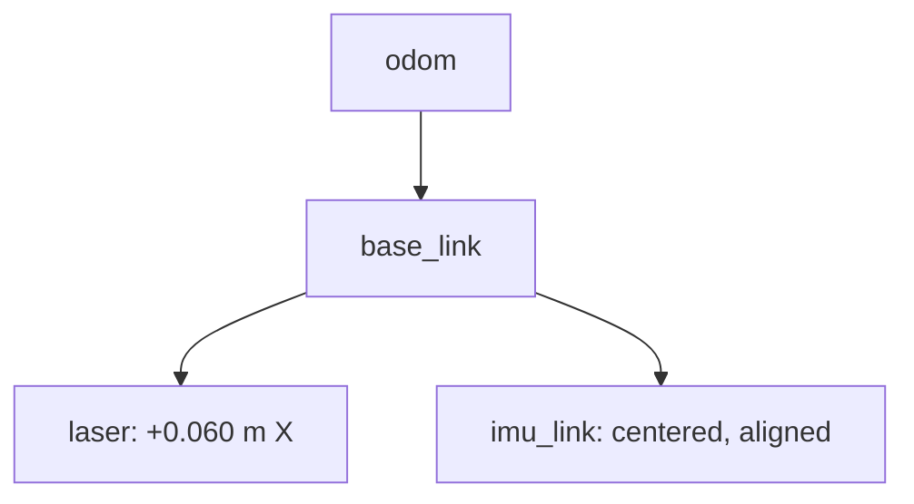

# Source-backed architecture

The modular scanner and all-sensor square are separate firmware programs. The scanner integrates sensors while rotating once. The square sketch combines motion routines and streaming sensors, but lacks `SCAN_START`/`SCAN_END` and `POSE` records required by the combined scan ROS node.

| Responsibility | Implementation |
| --- | --- |
| Low-level PWM and direction | ESP32 motor helpers |
| Encoder acquisition / wrap | ESP32, separate I²C buses |
| Current wheel pose | ESP32 modular `Odometry.cpp` |
| Raw IMU scaling / bias | ESP32 `imu.cpp` |
| Message conversion and point reconstruction | PC, `robot_mapping` |
| Orientation estimation | PC, Madgwick |
| EKF | Reported in development, configuration missing |
| SLAM / navigation | Planned |

The robot is therefore offboard-ROS, not wholly offboard processing: acquisition, motion control and current wheel odometry already execute on the ESP32.

## Default reproduction route

`MIC_ROS_AMR` → text serial → `scan_imu_odom` → raw IMU, LaserScan, odometry-frame PointCloud2 and TF. Madgwick consumes raw IMU. The repo launch starts only this serial reader and lets it own the two sensor static transforms and dynamic pose TF. No duplicate static-transform process is needed.

## TF

All three edges belong to the combined node in this mode. Madgwick TF publication is disabled. A future EKF must replace dynamic odometry TF authority, with the raw broadcaster disabled; future SLAM/localization supplies `map → odom`. Those changes are not implemented in the preserved nodes.

## Source-preservation policy

Firmware and six ROS runtime nodes are preserved byte-for-byte. Packaging and launch changes are documented separately, with originals retained in `archive/original_ros_packaging/`. Historical parameter differences remain visible rather than being silently retuned.
