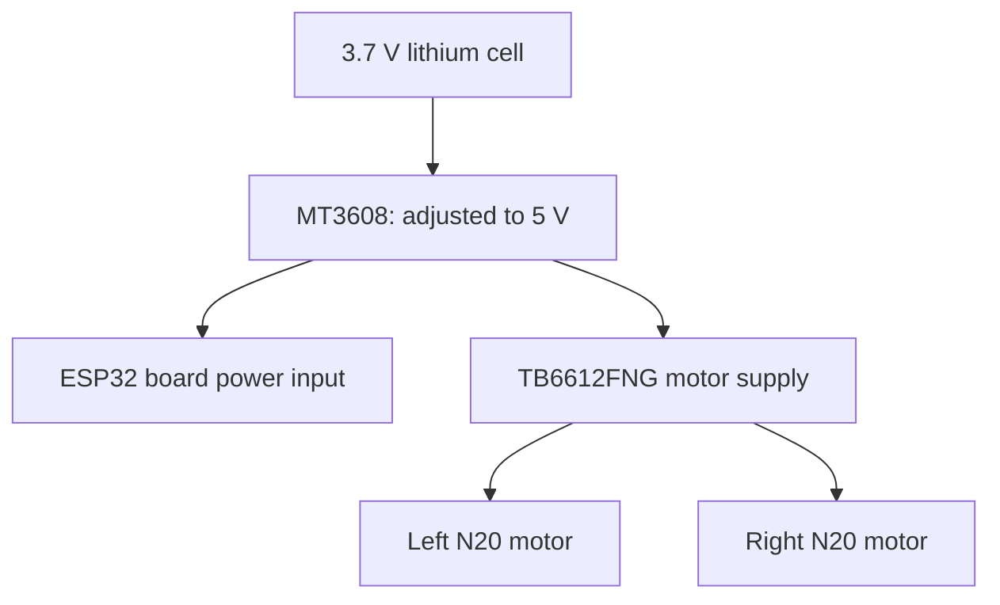

# Hardware, wiring and mechanical design

The current chassis is 3D printed. The owner supplies a 3.7 V high-discharge lithium cell, an MT3608 boost converter adjusted to 5 V, an ESP32, TB6612FNG, two N20 geared motors rated approximately 400 RPM at 12 V, 44 mm wheels, two AS5600 magnetic encoders, an MPU9250 module and a VL53L0X. The motors run at 5 V for this prototype. Runtime, motor current, converter headroom and a priced BOM have not been measured in the supplied evidence.

This is the reported power topology, not a complete schematic. Confirm actual board input, logic supply, grounding and USB power arrangement from the assembled hardware before reproducing wiring. Cell capacity, charging/protection arrangement and converter load measurements are not specified.

## Current modular firmware pin map

| Function | GPIO |
| --- | --- |
| AIN1 / AIN2 / PWMA | 14 / 27 / 12 |
| BIN1 / BIN2 / PWMB | 33 / 25 / 32 |
| STBY | 26 |
| Left encoder + IMU SDA / SCL | 16 / 23 — `TwoWire(1)` |
| Right encoder + ToF SDA / SCL | 21 / 22 — `Wire` |

Both buses are initialized at 400 kHz. Both AS5600 devices use address `0x36`; placing them on independent buses resolves the address collision. The IMU uses `0x68` and ToF initialization uses `0x29`.

Physical forward: left AIN1 LOW/AIN2 HIGH; right BIN1 HIGH/BIN2 LOW. The right encoder counts remain raw-sign in `Encoders.cpp`; `Odometry.cpp` negates the right distance. Some historical sketches use other labels, pin definitions and signs: their source is authoritative for that stage.

## Geometry

Current modular configuration: diameter 0.044 m, wheel separation 0.105 m, 4096 counts/revolution, laser offset +0.060 m on base X. The IMU static transform assumes center mounting and aligned axes. Earlier sketches contain 0.090, 0.095, 0.100 and 0.145 m track values; `main_test_microROS` contains 0.95 m. Do not silently transfer these values to the current chassis.

## Chassis file

[Download/view chassis.stl](../hardware/chassis.stl). The original CAD mesh is preserved. STL does not encode units; verify intended scale in the slicer. Material, layer height, infill and print orientation were not supplied. [Actual assembly photos](../media/README.md) show motor, encoder and electronics placement.

## Earlier scanner hardware

`esp32_CAR_MAPING` uses `AccelStepper::HALF4WIRE` with GPIO 19, 18, 5 and 17, a button on GPIO 4, and ToF on 21/22. Its nominal 4096-step revolution and ±1365-step endpoints imply a roughly 240° sweep. The stepper/driver model is not identified. This earlier encoder-free scanner is distinct from the later robot-body rotation method.
